# 🏙️ Smart City & Blockchain — Plateforme Décentralisée de Gestion des Services Urbains

**Université Abdelmalek Essaâdi**  
**Faculté des Sciences et Techniques – Tanger**  
**Master IDIA / Cybersécurité & Blockchain**  
**Année Universitaire :** 2026 / 2027  
**Enseignante :** Prof. Ikram BENABDELOUAHAB  
**Étudiant :** *Abajja Mohammed*  

---

## 📌 Présentation du Projet

Ce mini-projet implémente une application décentralisée (**DApp Smart City**) permettant aux citoyens de signaler des incidents urbains (éclairage public, voirie, déchets, fuites d'eau…) et aux services municipaux d'assurer leur suivi de manière transparente, sécurisée et traçable sur la blockchain Ethereum.

### Fonctionnalités principales :
- **Smart Contract `UrbanIssueRegistry` :** gestion complète du cycle de vie (`Reported → Assigned → InProgress → Resolved → Closed`), contrôle d'accès par rôles (`AccessControl` OpenZeppelin : Citoyen vs `MUNICIPALITY_ROLE`), anti-doublon sur `issueId`, et stockage d'un historique immuable des interventions.
- **Espace Citoyen :** déclaration d'un signalement urbain via wallet (avec pseudonyme fictif sans données personnelles sensibles on-chain).
- **Espace Municipalité :** tableau de bord avec filtres, affectation d'équipe (`assignTeam`) et mise à jour progressive des statuts avec commentaire obligatoire.
- **Import Excel / CSV (`urban_issues.xlsx`) :** lecture côté client via **SheetJS**, validation automatique champ par champ (et détection des doublons on-chain) avant sélection et enregistrement par lot (`batchImportIssues`).
- **Consultation Publique & Traçabilité :** recherche par ID numérique ou code métier (`CITY-2026-001`) et affichage d'une **Timeline** complète (horodatage, statut, équipe affectée, commentaire, adresse blockchain de l'acteur).

---

## 🌐 Déploiement du Smart Contract

- **Testnet Sepolia (Chain ID `11155111`) :**  
  `0x1De04385d2242f1a7333625949a74628E4e89772`  
  🔗 [Consulter sur Sepolia Etherscan](https://sepolia.etherscan.io/address/0x1De04385d2242f1a7333625949a74628E4e89772)
- **Réseau Local Hardhat (Chain ID `31337`) :**  
  `0x5FbDB2315678afecb367f032d93F642f64180aa3`

---

## 🛠️ Stack Technique
- **Smart Contract :** Solidity `^0.8.26` (EVM `cancun`, `viaIR: true`), OpenZeppelin `AccessControl`
- **Tests & Déploiement :** Hardhat `2.29.2`, Mocha / Chai
- **Frontend :** React + Vite, Ethers.js v6, SheetJS (`xlsx`), MetaMask

---

## 🚀 Installation & Utilisation

### 1. Installer les dépendances
```bash
# Racine (Hardhat + OpenZeppelin + SheetJS + dotenv)
npm install

# Frontend React + Vite
cd frontend
npm install
cd ..
```

### 2. Exécuter les tests unitaires Hardhat (10 tests)
```bash
npx hardhat compile
npx hardhat test
```

### 3. Déployer (Hardhat Local ou Sepolia)
```bash
# Mode Local Hardhat
npx hardhat node
npx hardhat run scripts/deploy.js --network localhost

# OU Mode Sepolia (avec .env configuré)
npx hardhat run scripts/deploy.js --network sepolia
```

### 4. Lancer l'application Web
```bash
cd frontend
npm run dev
```
Accéder à l'interface sur **`http://localhost:5173`** puis connecter **MetaMask** (ou le mode *Hardhat Local*).

---

## 📸 Captures d'Écran & Preuves de Fonctionnement

### 1. Tests Unitaires Automatisés (Hardhat — 10/10 réussis)
Validation de la création, consultation, contrôle d'accès municipal, transitions de statuts, historique complet et import réel depuis `urban_issues.xlsx`.
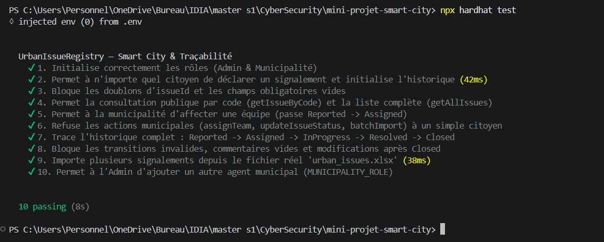

### 2. Espace Citoyen — Déclaration d'un signalement urbain
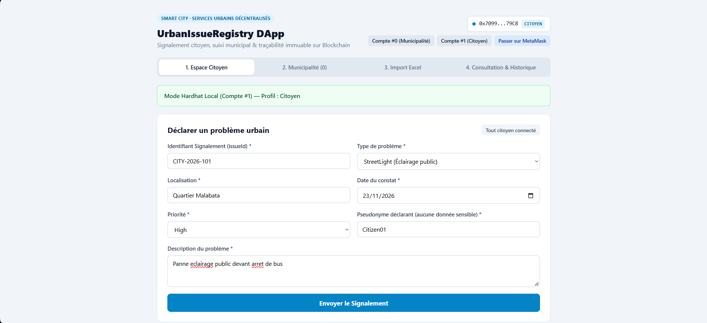
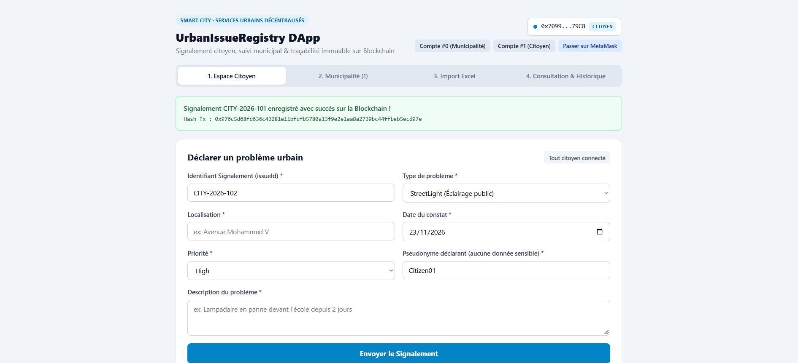

### 3. Sécurité RBAC — Blocage des actions municipales pour un Citoyen
Refus de l'affectation d'équipe lorsqu'un compte sans `MUNICIPALITY_ROLE` tente d'intervenir (`AccessControlUnauthorizedAccount`).
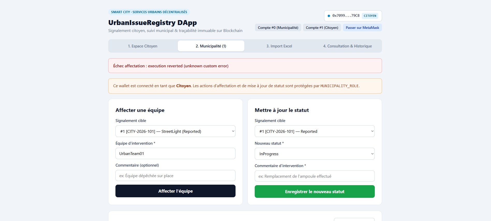

### 4. Espace Municipalité — Affectation d'équipe & Cycle de statuts
Suivi complet `Reported → Assigned → InProgress → Resolved → Closed` avec commentaires d'intervention.
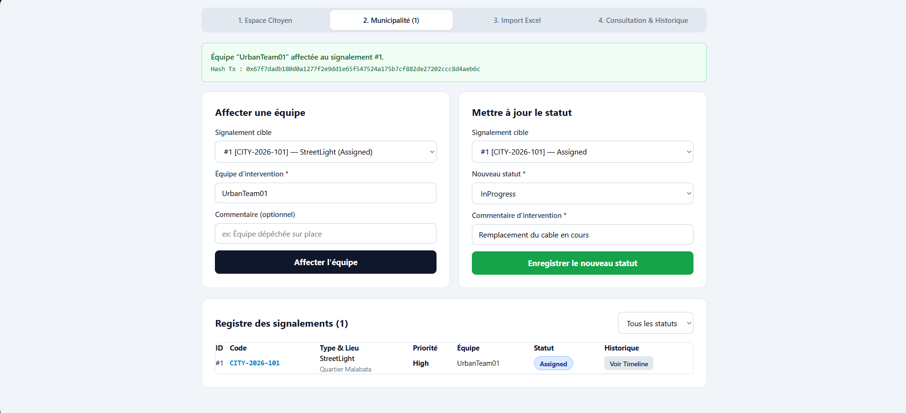
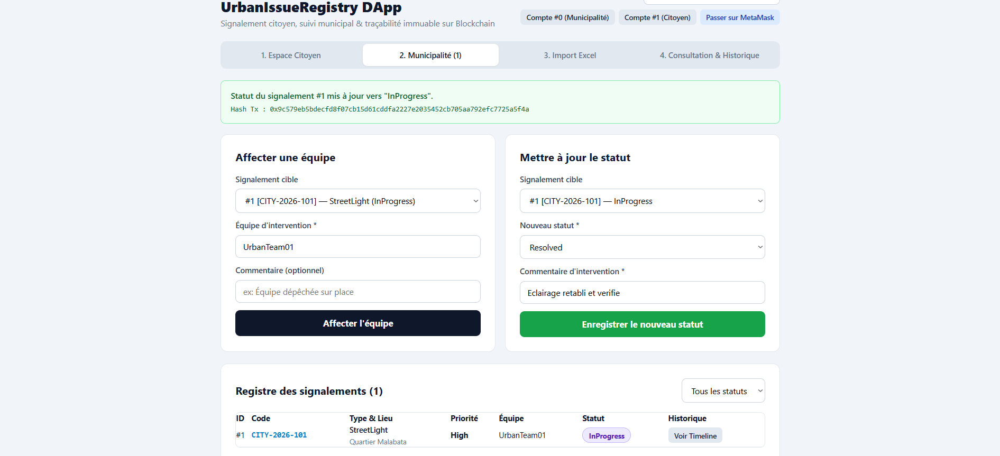
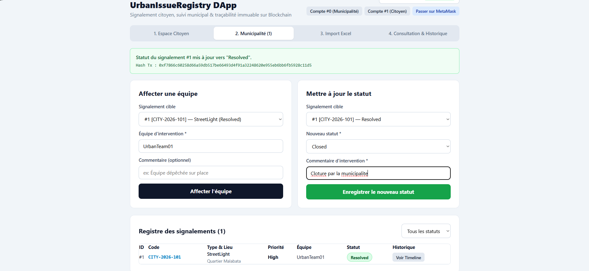
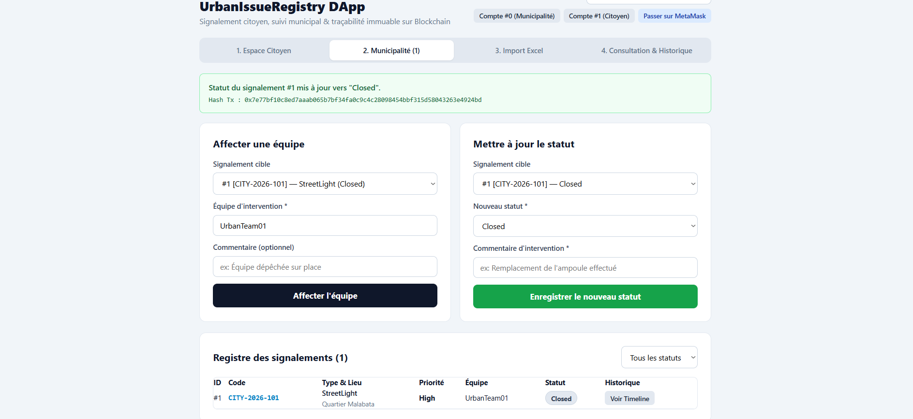

### 5. Import Excel (`urban_issues.xlsx`) & Validation côté client
*Note : le fichier `urban_issues.xlsx` ayant déjà été importé avec succès lors du lot initial (les 4 signalements sont enregistrés dans le registre municipal), cette capture illustre l'aperçu SheetJS ainsi que la validation automatique bloquant les doublons déjà présents sur la blockchain (`✗ Déjà présent sur Blockchain`).*
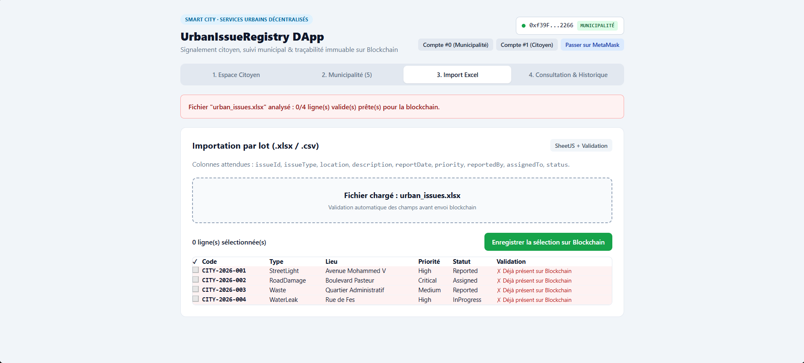

### 6. Consultation Publique & Timeline de Traçabilité
Visualisation complète de l'historique horodaté des actions, des équipes et des adresses blockchain des acteurs.
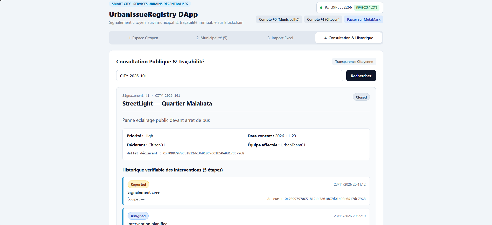
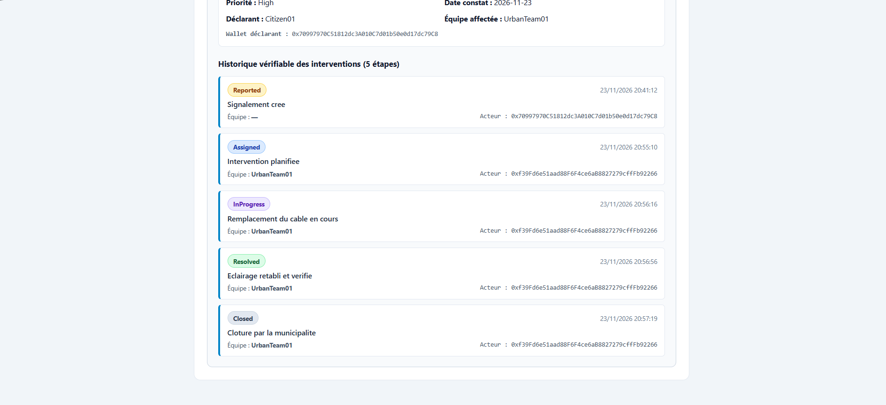

### 7. Test avec MetaMask sur Sepolia & Historique on-chain
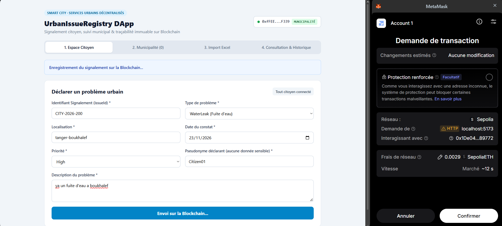
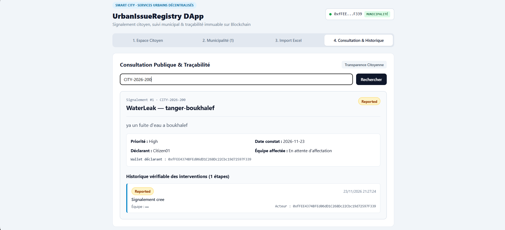

---

## 📁 Arborescence du Projet
```text
mini-projet-smart-city/
├── contracts/
│   └── UrbanIssueRegistry.sol        # Smart contract principal
├── scripts/
│   └── deploy.js                     # Script de déploiement Local / Sepolia
├── test/
│   └── UrbanIssueRegistry.test.js    # Suite de 10 tests automatisés
├── frontend/
│   └── src/
│       ├── App.jsx                   # DApp (Citoyen, Municipalité, Excel, Public)
│       ├── ContractConfig.js         # ABI & Adresses Local / Sepolia
│       └── index.css                 # Styles globaux
├── imgs/                             # Captures d'écran
├── make_excel.js                     # Générateur du fichier Excel de test
├── urban_issues.xlsx                 # Fichier Excel de test
├── hardhat.config.js                 # Configuration Hardhat (Solidity 0.8.26)
└── README.md                         # Documentation du projet
```